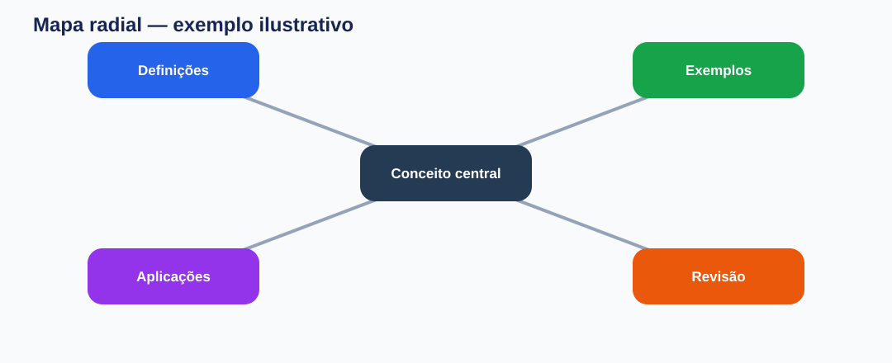
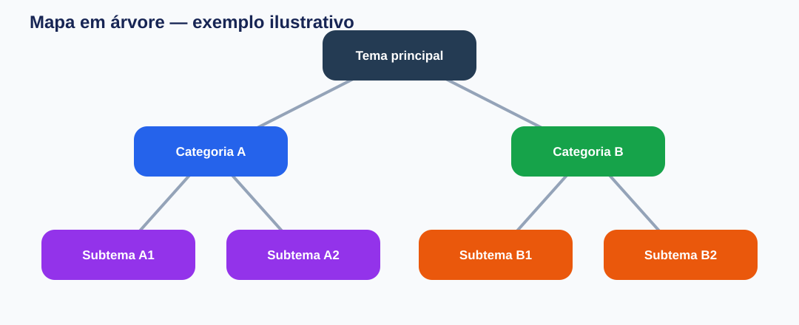
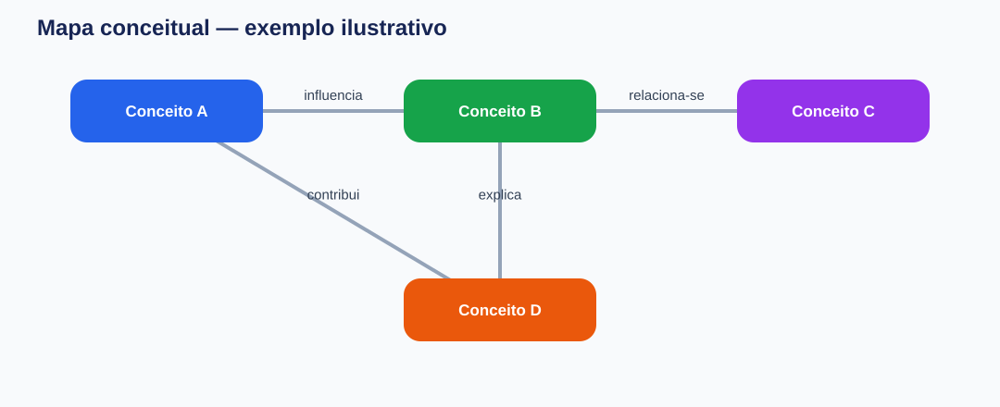
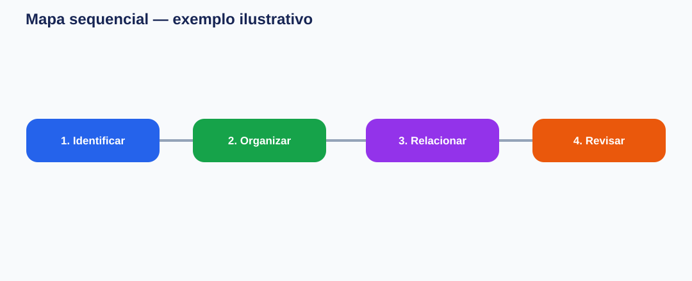

# Mapas Mentais v2 — Skill para Codex

Transforme materiais de estudo e documentação técnica em **mapas mentais coloridos**, com estrutura editável e revisão ativa. A skill foi concebida para trabalhar a partir de conteúdo fornecido pelo usuário, sem inventar conceitos ou omitir tópicos solicitados.

> **Estado do projeto:** renderizador Python, exemplos, testes e modelos ilustrativos estão publicados. PNG e PDF exigem a dependência opcional CairoSVG.

## Galeria de modelos

As imagens a seguir são **prévias ilustrativas em SVG**, não screenshots de execuções reais.

### 1. Radial — explorar associações


Ideal para um tema central com conceitos associados.

### 2. Árvore — classificar e organizar


Ideal para classificações, categorias e subcategorias.

### 3. Conceitual — mostrar relações


Ideal para conceitos interligados, com conectores rotulados.

### 4. Sequencial — explicar processos


Ideal para cronologias, procedimentos e etapas.

## Instalação no Codex

No terminal do macOS ou Linux:

```bash
mkdir -p ~/.agents/skills
git clone https://github.com/Epaminondaslage/skill-mapa-mental.git ~/.agents/skills/mapas-mentais
```

Reinicie a sessão do Codex para carregar a skill. Para atualizar:

```bash
git -C ~/.agents/skills/mapas-mentais pull
```

## Como solicitar um mapa

Mencione **mapas-mentais** no pedido, anexe ou informe o material e indique o idioma. Quando o idioma não for informado, a skill deve perguntar: **“Você deseja o mapa em português ou italiano?”**

Idiomas disponíveis: **português brasileiro (`pt-BR`)** e **italiano (`it-IT`)**. É possível solicitar versões equivalentes nos dois idiomas.

### Perguntas e comandos prontos para copiar

**Mapa radial em português**

```text
Use a skill mapas-mentais para criar um mapa radial em português
sobre o material anexado. Preserve todos os conceitos importantes,
gere uma versão editável e prepare cinco perguntas de revisão.
```

**Mapa conceitual em italiano**

```text
Use a skill mapas-mentais para criar um mapa conceitual em italiano
a partir deste PDF. Rotule as relações entre conceitos em italiano,
sem adicionar informações externas. Inclua cinco flashcards em italiano.
```

**Mapa de árvore com foco na prova**

```text
Use a skill mapas-mentais em português. Organize o conteúdo do livro
em uma árvore de categorias e subcategorias. Priorize os tópicos
assinalados pelo professor e não omita os demais tópicos do material.
```

**Linha do tempo ou sequência**

```text
Use a skill mapas-mentais em italiano para representar a sequência
dos acontecimentos deste capítulo. Use o modelo sequencial,
respeitando rigorosamente a ordem do material.
```

**Versão bilíngue**

```text
Use a skill mapas-mentais para gerar o mesmo mapa em português
e italiano, com a mesma estrutura e duas versões separadas.
Inclua perguntas e flashcards nos respectivos idiomas.
```

**Somente mapa**

```text
Use a skill mapas-mentais em português, no formato radial.
Entregue somente o mapa, sem perguntas ou flashcards.
```

## Perguntas que a skill pode fazer

Se faltar alguma preferência essencial, a skill poderá perguntar:

1. **Idioma:** “Você deseja o mapa em português ou italiano?”
2. **Formato:** “Prefere mapa radial, em árvore, conceitual ou sequencial?”
3. **Escopo:** “Deseja um mapa geral ou mapas separados por capítulo?”
4. **Revisão:** “Quer incluir cinco perguntas e cinco flashcards?”

O tipo de mapa pode ser selecionado automaticamente quando a estrutura do conteúdo for clara; o idioma, quando omitido, deve ser perguntado.

## Exemplo de revisão ativa

Para um material sobre o método de elaboração de mapas mentais, perguntas ilustrativas seriam:

1. Qual é a função do tema central?
2. Quando usar um mapa em árvore em vez de um mapa sequencial?
3. Qual é a diferença entre uma relação hierárquica e uma relação conceitual?
4. Como conferir se o mapa preserva o conteúdo original?
5. Por que dividir um mapa excessivamente extenso em mapas menores?

Exemplos de flashcards:

| Frente | Verso |
|---|---|
| Mapa radial | Organiza associações em torno de um tema central. |
| Mapa em árvore | Representa hierarquias e classificações. |
| Mapa conceitual | Mostra relações entre conceitos. |
| Mapa sequencial | Apresenta etapas ou acontecimentos em ordem. |
| JSON canônico | Estrutura editável que serve de fonte para as saídas gráficas. |

Esses exemplos demonstram o formato da revisão; em uso real, perguntas e respostas devem ser baseadas no material fornecido.

## Entregáveis previstos

| Arquivo | Finalidade |
|---|---|
| `mapa.json` | Estrutura canônica editável |
| `mapa.svg` | Diagrama vetorial editável |
| `mapa.png` | Imagem para apresentação ou impressão, com CairoSVG |
| `mapa.pdf` | PDF vetorial para visualização e impressão, com CairoSVG |
| `mapa.mmd` | Mermaid, quando solicitado e produzido |
| `revisao.md` | Perguntas, flashcards e pontos essenciais |

## Execução local

```bash
python3 scripts/render.py examples/exemplo.json --out saida
python3 -m unittest discover -s tests -v
```

Para gerar **PNG e PDF**, instale a dependência opcional `cairosvg` (`python3 -m pip install cairosvg`). O PDF é convertido do SVG e mantém conteúdo vetorial sempre que suportado. A renderização não substitui a revisão da fidelidade semântica, da legibilidade e da cobertura do material.

**Exemplo de solicitação com PDF:**

```text
Use a skill mapas-mentais para criar um mapa radial em italiano
com saída em SVG, PNG, JSON e PDF vetorial para impressão.
```

## Princípios de qualidade

- Respeitar o conteúdo e o idioma escolhido.
- Preservar nomes próprios, terminologia, cronologia e relações.
- Não inventar informações ausentes da fonte.
- Usar cores consistentes por ramo e rótulos legíveis.
- Separar mapas muito densos, sem sacrificar cobertura.
- Diferenciar prévias ilustrativas de saídas efetivamente geradas.

## Estrutura atual de documentação

```text
skill-mapa-mental/
├── SKILL.md
├── README.md
├── scripts/render.py
├── tests/test_render.py
├── examples/
├── references/
└── docs/
    └── modelos/
        ├── radial.svg
        ├── arvore.svg
        ├── conceitual.svg
        └── sequencial.svg
```

## Repositório

[GitHub — Epaminondaslage/skill-mapa-mental](https://github.com/Epaminondaslage/skill-mapa-mental)
